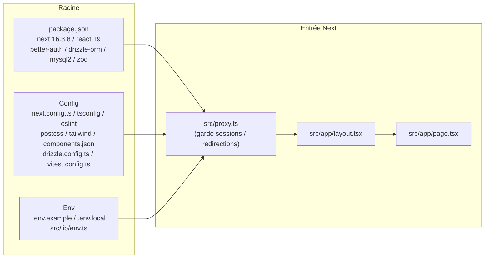
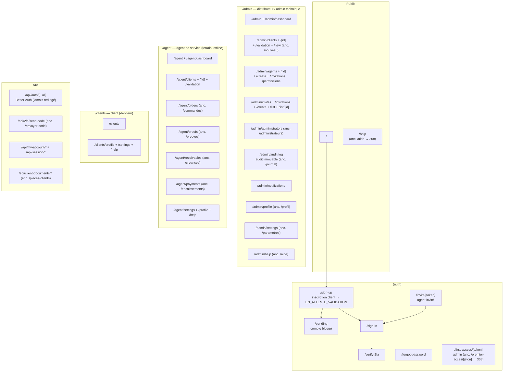
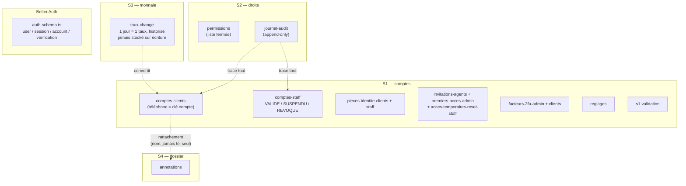
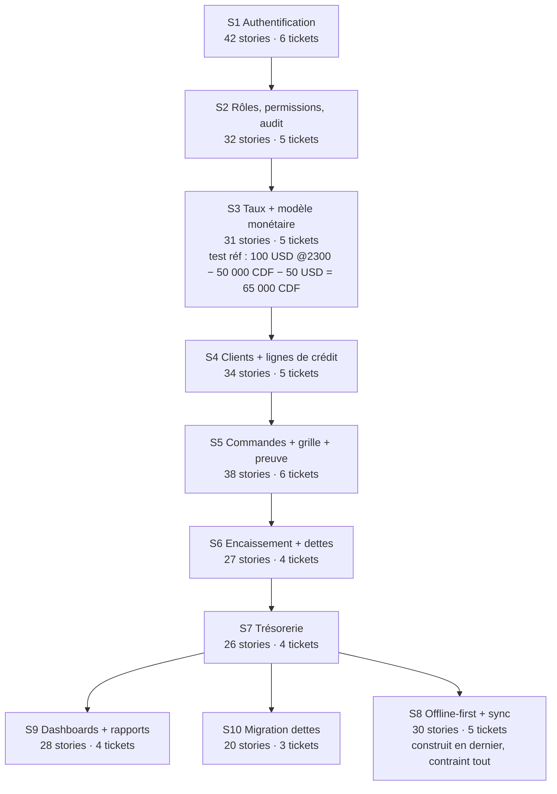

# MAP — Carte de l'application TKS

> Vue d'ensemble du dépôt `TKS solution` : où est quoi, qui parle à qui.
> Sources normatives : `GLOSSARY.md`, `CONTEXT.md`, `.scratch/decomposition.md`, `docs/adr/`.
> Généré le 2026-10-14 — relire si la structure `src/` change.

## 1. Le projet en une phrase

PWA Next.js (App Router + TypeScript) qui remplace le prototype Excel `Prologiciel_TKS_Version_Application.xlsx` pour la distribution de crédit airtime en RDC. Offline-first, Better Auth, Drizzle ORM + MySQL, Tailwind + shadcn.

## 2. Stack et racine

| Dossier / fichier | Rôle |
|---|---|
| `src/app/` | Routes App Router (public, auth, admin, agent, clients, api) |
| `src/components/` | UI shadcn + headers/sidebars par rôle + taux du jour |
| `src/lib/` | Logique métier (`comptes`, `autorisations`, `devises`, `annotations` — anc. `s1-comptes`, `s2-autorisations`, `s3-devises`, `s4-annotations`) + `auth.ts`, `db/` |
| `src/socole/architecture/` | Garde-fous : `inventaire.ts` (lit `src/`), `contraintes.ts` (interdits) |
| `src/hooks/use-mobile.ts` | Détection mobile |
| `drizzle/` | Migrations SQL (`0000_` → `0018_`) + `meta/` |
| `scripts/` | `bootstrap-technical-admin.ts` |
| `tests/`, `src/**/*.test.*` | Vitest + Testing Library + jsdom |
| `docs/adr/` | 7 ADRs (voir §6) |
| `.scratch/` | 10 specs S1–S10 + `decomposition.md` |
| `donnees/`, `public/`, `.inspiration-design/` | Données locales, assets, maquettes |

## 3. Routes (App Router)

> Routes canoniques en anglais sur décision du porteur (écart assumé au
> français du glossaire : les slugs d'URL ne suivent plus la langue des
> termes métier). Anciennes URLs françaises → 308 dans `next.config.ts`.
> `/api/auth` jamais touché.

Détail : `src/app/(auth)/`, `src/app/admin/`, `src/app/agent/`, `src/app/clients/`, `src/app/api/`. Gardes : `proxy.ts`, `gardien-session.tsx`, `rediriger-connecte.tsx`, `destination-connexion.ts`, `permission-refusee.tsx`.

## 4. Logique métier `src/lib/`

```mermaid
flowchart LR
  subgraph S1["S1 Comptes (socle)"]
    CCLI["comptes-clients.ts<br/>EN_ATTENTE_VALIDATION → VALIDE / REFUSE / REVOQUE"]
    CSTAFF["staff.ts + comptes-staff"]
    INVIT["invitations agents<br/>+ premiers-acces-admin + reset-staff"]
    P2FA["2fa-methode.ts<br/>facteurs-2fa-admin / clients"]
    PIECES["pieces-clients.ts + pieces-fichiers.ts<br/>pièce d'identité obligatoire"]
    FICHE["fiche-client.ts / fiche-client-base.ts"]
  end
  subgraph S2["S2 Autorisations + audit"]
    AUTHZ["autorisations.ts<br/>refus par défaut"]
    JOURNAL["journal.ts + resume-journal.ts<br/>immuable"]
    CONTEST["contestation.ts"]
  end
  subgraph S3["S3 Monnaie"]
    TAUX["s3-devises/taux.ts<br/>1 USD = X CDF, pivot CDF<br/>ne mord que sur USD"]
  end
  subgraph S4["S4 Dossier client"]
    ANNOT["s4-annotations/<br/>annotations + derivation + etiquettes"]
  end
  S1 --> S2 --> S3 --> S4
```

Transverse : `auth.ts`, `auth-client.ts`, `erreurs-auth.ts`, `resultat-action.ts`, `aide-content.ts`, `taux-actions.ts` (+ composants `taux-du-jour.tsx`).

## 5. Base de données (Drizzle + MySQL)

Règles (GLOSSARY invariants) : dette / reste à payer / solde = dérivés, jamais stockés ; une créance et un paiement = exactement une devise ; aucun taux sur une écriture ; plafond restant jamais < 0 ; pas de suppression, que des écritures inverses.

## 6. Specs S1–S10 (ordre de construction)

Détail par spec : `.scratch/sN-*/spec.md` + tickets `issues/`. Implémenté à ce jour : S1 → S4 (comptes, audit, taux, annotations). S5–S10 : specs seules, pas de code.

## 7. ADRs + vocabulaire

| ADR | Titre | Effet |
|---|---|---|
| 0001 | Taux applicable = taux en vigueur | Pas de taux stocké ; USD seul concerné ; dette USD close en USD |
| 0002 | CDF pivot, USD devise de saisie | Affichage CDF ; une écriture = une devise |
| 0003 | Offline-first, conflits à la synchro | File durable, réémission idempotente |
| 0004 | Le verrou ne peut pas être décision serveur | Verrou local (file commande, S5) |
| 0005 | Premier enregistrement gagne, réconciliation humaine | Jamais d'écrasement auto |
| 0006 | Stack technique | Next + Drizzle + MySQL + Better Auth |
| 0007 | Squelette Next.js | App Router à la racine |

Vocabulaire normatif : `GLOSSARY.md` (4 acteurs : distributeur, client, agent de service, administrateur technique ; compte ≠ validation ≠ dossier ; commande ≠ réalisation). Termes interdits : shop, réalisation, vente, virtuel, e-money, facture/reçu.

## 8. Composants, tests, outillage

- **Composants rôle** : `admin-header.tsx`, `agent-header/sidebar.tsx`, `client-header/sidebar.tsx`, `app-sidebar.tsx`, `dashboard-header.tsx`, `team-switcher.tsx`, `nav-main/projects/user.tsx`, `palette-recherche.tsx`.
- **Session/état** : `gardien-session.tsx`, `app-loader.tsx`, `app-splash.tsx`, `progression-navigation.tsx` (+ `nprogress`), `mode-toggle.tsx`, `theme-provider.tsx`.
- **Tests** : `vitest run` — `tests/` (app, components, lib, socole, `proxy.test.ts`) + colocalisés `src/**/*.test.*`. Garde-fous socle dans `src/socole/architecture/`.
- **Commandes** : `pnpm dev / build / start / lint / test`, `db:generate`, `db:migrate`, `db:bootstrap-technical-admin`.

## 9. Par où commencer

1. Lire `GLOSSARY.md` puis `.scratch/decomposition.md`.
2. Choisir la spec : `.scratch/sN-*/spec.md`.
3. Suivre le ticket : `.scratch/sN-*/issues/*.md` (`Blocked by` = ordre).
4. Vérifier l'ADR touché dans `docs/adr/`.
5. Coder dans `src/lib/sN-*` + route `src/app/` + migration `drizzle/`.
